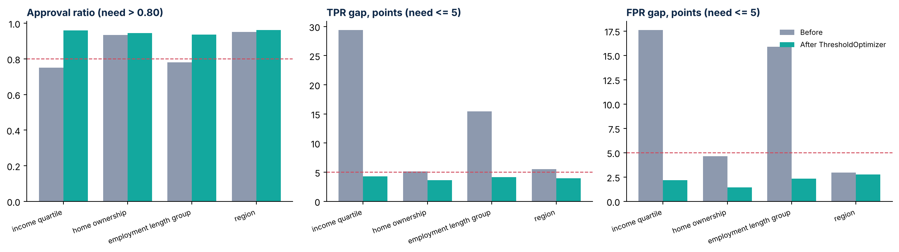

# Fairness Metrics Report - BK credit-risk model (Module 4)

Generated 2026-10-26T10:18:26 from `data/curated/loans_curated.parquet`. Selected model: **lightgbm**, scored on the 2015 hold-out set (30,835 loans).

## Definitions (from the Module 2 plan)

- **Flag** = the model sends the applicant to review / possible decline (score at or above the 2014-validation top-20% cutoff). **Approved** = not flagged.
- **Disparate impact ratio / approval ratio** = lowest group approval rate divided by highest. Limit: above 0.8 (four-fifths convention; Feldman et al., 2015).
- **Demographic parity difference** = highest minus lowest group approval rate (points).
- **Equalized odds** (Hardt et al., 2016) = gaps in true-positive rate (TPR) and false-positive rate (FPR) between groups. Limit: 5 points each.
- Groups with fewer than 200 loans are excluded from the measures. LendingClub has no gender, age or race fields, so the groups are indirect: income quartile, home ownership, employment length and region.

## Summary: before and after mitigation (ThresholdOptimizer, equalized odds)

| Group | Stage | Approval ratio | Demographic parity diff (pts) | TPR gap (pts) | FPR gap (pts) | Within limits |
| --- | --- | --- | --- | --- | --- | --- |
| income quartile | before | 0.750 | 22.5 | 29.4 | 17.6 | no |
| income quartile | after | 0.960 | 2.0 | 4.3 | 2.2 | yes |
| home ownership | before | 0.935 | 5.3 | 5.2 | 4.7 | no |
| home ownership | after | 0.944 | 3.3 | 3.6 | 1.4 | yes |
| employment length group | before | 0.781 | 17.6 | 15.4 | 15.9 | no |
| employment length group | after | 0.937 | 3.8 | 4.1 | 2.3 | yes |
| region | before | 0.952 | 3.8 | 5.5 | 2.9 | no |
| region | after | 0.962 | 2.0 | 4.0 | 2.8 | yes |

## Group detail before mitigation

| Attribute | Group | Loans | Approval rate | Default rate | TPR | FPR |
| --- | --- | --- | --- | --- | --- | --- |
| income quartile | Q1 (lowest) | 6,844 | 67.4% | 31.7% | 48.1% | 25.4% |
| income quartile | Q2 | 7,467 | 72.2% | 26.6% | 43.4% | 22.1% |
| income quartile | Q3 | 7,860 | 81.6% | 23.9% | 31.7% | 14.2% |
| income quartile | Q4 (highest) | 8,664 | 89.9% | 20.9% | 18.7% | 7.8% |
| home ownership | MORTGAGE | 14,848 | 81.2% | 20.9% | 33.4% | 14.9% |
| home ownership | OWN | 3,499 | 76.4% | 25.2% | 35.3% | 19.6% |
| home ownership | RENT | 12,488 | 75.9% | 31.0% | 38.6% | 17.6% |
| employment length group | 0-2 years | 7,449 | 79.6% | 27.9% | 34.0% | 15.1% |
| employment length group | 10+ years | 10,311 | 80.2% | 21.7% | 34.3% | 15.8% |
| employment length group | 3-9 years | 11,510 | 78.4% | 26.0% | 36.7% | 16.3% |
| employment length group | Not reported | 1,565 | 62.6% | 34.8% | 49.5% | 30.9% |
| region | Midwest | 5,141 | 76.6% | 25.1% | 39.4% | 18.1% |
| region | Northeast | 5,642 | 79.0% | 27.6% | 33.9% | 16.1% |
| region | South | 11,041 | 77.6% | 26.1% | 37.6% | 17.1% |
| region | West | 9,011 | 80.5% | 23.5% | 34.0% | 15.1% |

## Is risk over- or under-stated for a group? (calibration by group, 2015 test)

Relative error = predicted default rate / actual default rate - 1. Positive = risk overstated.

| Attribute | Group | Loans | Predicted | Actual | Relative error | Brier score |
| --- | --- | --- | --- | --- | --- | --- |
| income quartile | Q1 (lowest) | 6,844 | 33.0% | 31.7% | +4.3% | 0.199 |
| income quartile | Q2 | 7,467 | 29.5% | 26.6% | +10.9% | 0.182 |
| income quartile | Q3 | 7,860 | 24.7% | 23.9% | +3.3% | 0.170 |
| income quartile | Q4 (highest) | 8,664 | 20.1% | 20.9% | -4.2% | 0.155 |
| home ownership | MORTGAGE | 14,848 | 24.8% | 20.9% | +18.6% | 0.157 |
| home ownership | OWN | 3,499 | 27.5% | 25.2% | +9.2% | 0.182 |
| home ownership | RENT | 12,488 | 28.1% | 31.0% | -9.3% | 0.196 |
| employment length group | 0-2 years | 7,449 | 26.2% | 27.9% | -6.2% | 0.184 |
| employment length group | 10+ years | 10,311 | 25.5% | 21.7% | +17.4% | 0.160 |
| employment length group | 3-9 years | 11,510 | 26.5% | 26.0% | +1.8% | 0.178 |
| employment length group | Not reported | 1,565 | 33.8% | 34.8% | -2.9% | 0.216 |
| region | Midwest | 5,141 | 27.5% | 25.1% | +9.7% | 0.174 |
| region | Northeast | 5,642 | 26.0% | 27.6% | -5.8% | 0.186 |
| region | South | 11,041 | 26.8% | 26.1% | +2.4% | 0.177 |
| region | West | 9,011 | 25.6% | 23.5% | +9.0% | 0.167 |

## Cost of mitigation

| Group | Flagged share | Precision | Accuracy |
| --- | --- | --- | --- |
| Before (single cutoff) | 21.5% | 42.9% | 71.5% |
| After: income quartile | 51.3% | 34.5% | 58.7% |
| After: home ownership | 42.0% | 36.8% | 63.5% |
| After: employment length group | 42.1% | 35.3% | 62.2% |
| After: region | 48.2% | 36.3% | 61.3% |

## Reading the results

- Different approval rates do not by themselves prove unfairness, because default rates differ between groups; the TPR/FPR gaps show who is wrongly flagged or missed.
- Group-specific cutoffs reduce the gaps but raise review workload and can raise policy and legal concerns. The governance team must weigh this trade-off before use.
- Home ownership, income and employment length are also model inputs, so group results can be affected by the inputs themselves.
- Bias checks use indirect groups; protected attributes (gender, age, ethnicity) are absent from the data and must be assessed on BK data.

## References

Feldman, M., Friedler, S., Moeller, J., Scheidegger, C., & Venkatasubramanian, S. (2015). Certifying and removing disparate impact. *KDD*.
Hardt, M., Price, E., & Srebro, N. (2016). Equality of opportunity in supervised learning. *NeurIPS*.
Bird, S., et al. (2020). Fairlearn: A toolkit for assessing and improving fairness in AI. Microsoft Technical Report.
